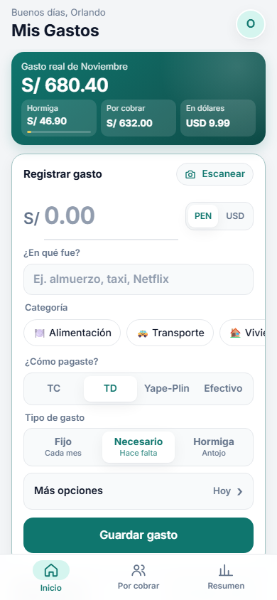
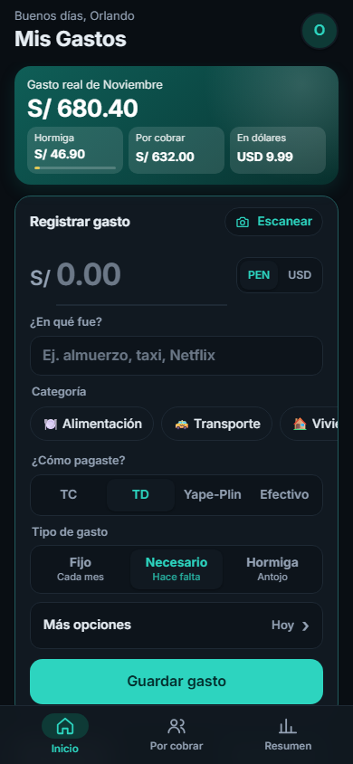
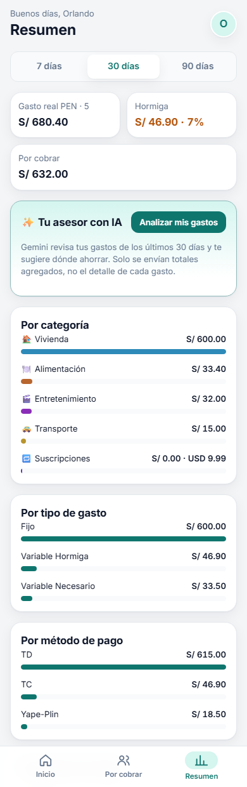
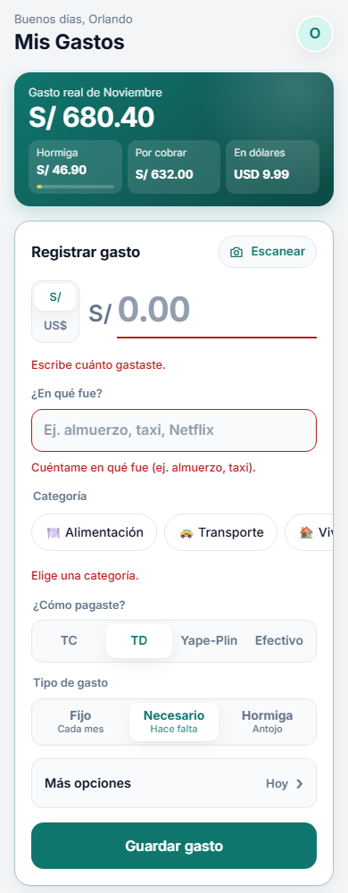
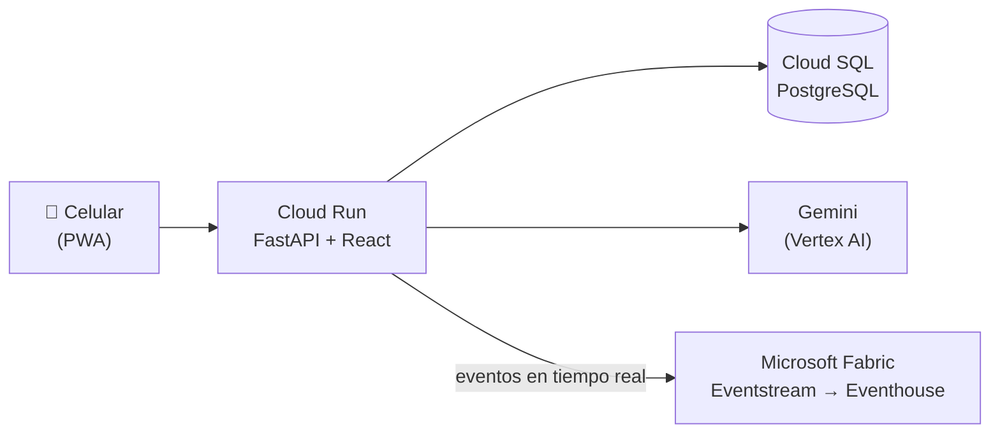
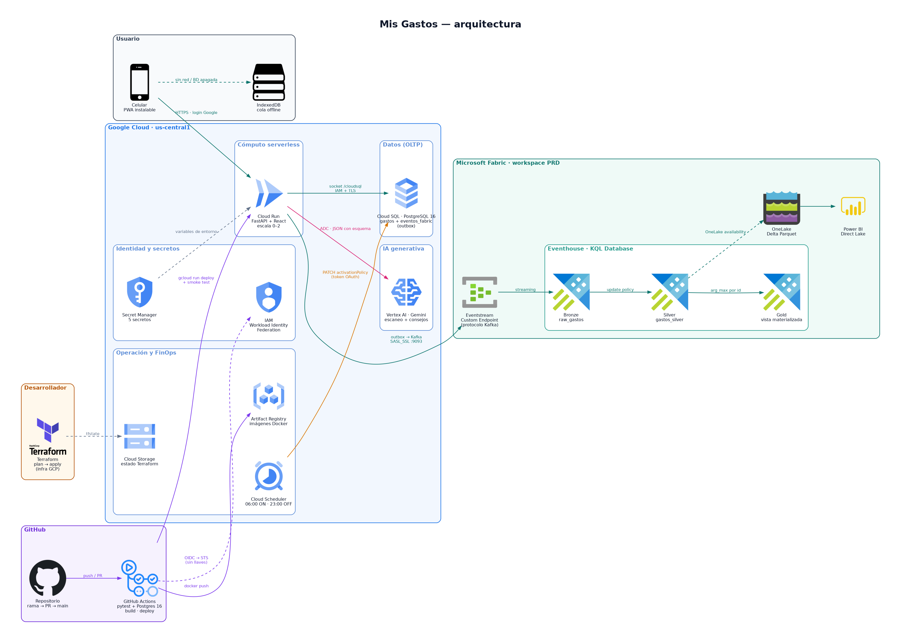

# 💸 Mis Gastos

**App web para registrar gastos en segundos desde el celular, entender a dónde va el dinero y recibir consejos de ahorro con IA.**
Cada gasto se guarda en una base de datos en Google Cloud y viaja en tiempo real a Microsoft Fabric para analítica.

<p align="center">
  
  
  
</p>

> Las capturas usan datos de ejemplo.
> ¿Buscas cómo está construida? → **[Documentación técnica](docs/ARQUITECTURA.md)**

---

## ¿Qué problema resuelve?

Anotar gastos suele fallar por dos motivos: **da pereza** (demasiados pasos) y **no se entiende el resultado** (una lista larga no dice nada).
Mis Gastos ataca ambos:

| Problema | Cómo lo resuelve |
|---|---|
| Registrar toma mucho tiempo | El formulario está **en la pantalla de inicio**, recuerda tus últimas elecciones y se completa en ~5 toques |
| Copiar montos de un voucher | **Escaneo con IA**: tomas una foto y se llena solo |
| "¿En qué se me va la plata?" | Gasto real del mes, **gasto hormiga** y desglose por categoría y método de pago |
| Gastos compartidos con otras personas | Cuenta **solo tu parte** y lleva la lista de **Por cobrar** |
| No hay señal o es de madrugada | Funciona **sin conexión**: guarda en el teléfono y sincroniza solo |
| Saber qué mejorar | **Asesor con IA** que analiza tus totales y propone ahorros concretos |

---

## Funcionalidades

### ⚡ Registro rápido (pantalla de inicio)
1. Escribe el **monto** (soles o dólares).
2. Escribe **en qué fue** ("almuerzo", "taxi").
3. Toca la **categoría** (🍽️ Alimentación, 🚕 Transporte, 🏠 Vivienda…, o crea una propia).
4. Elige **cómo pagaste**: TC (crédito), TD (débito), Yape-Plin o Efectivo.
5. Confirma el **tipo de gasto** y toca **Guardar**.

Detalles que ahorran tiempo:
- Recuerda tu **último método de pago, banco y moneda**.
- Sugiere el **tipo de gasto** según la categoría (por ejemplo, Vivienda o Suscripciones → *Fijo*).
- La fecha es **hoy** por defecto; lo opcional (fecha, gasto compartido, cantidad, banco) está plegado en **"Más opciones"**.
- Si falta algo, te dice **qué y dónde** ("Elige una categoría").
- Después de guardar, el formulario queda listo para el siguiente gasto.

<p align="center"></p>

### 📷 Escaneo con IA
Toca **Escanear** en el formulario y toma una foto de:
- un voucher de POS, ticket, boleta o factura;
- una captura de **Yape/Plin** o de banca móvil;
- incluso del producto o plato (estima un precio razonable).

La IA (Gemini) completa monto, concepto, categoría, tipo, método de pago, banco y fecha, e indica su **nivel de confianza**. **Nunca guarda sola**: siempre revisas antes de guardar.

### 🐜 Tipos de gasto
| Tipo | Significado | Ejemplos |
|---|---|---|
| **Fijo** | Se repite cada mes | Alquiler, luz, internet, Netflix |
| **Variable Necesario** | No es mensual, pero hace falta | Supermercado, farmacia, pasajes |
| **Variable Hormiga** | Pequeño gasto prescindible que se acumula | Café, snacks, delivery, antojos |

### 🤝 Gastos compartidos y "Por cobrar"
Activa **Gasto compartido** en "Más opciones" y elige:
- **50 / 50**, o
- **Mi parte**: escribes cuánto te corresponde.

Tus totales cuentan **solo lo que salió de tu bolsillo**. La diferencia aparece en la pestaña **Por cobrar** hasta que tocas **"✓ Ya me pagaron"**.

### 📊 Resumen y asesor con IA
En la pestaña **Resumen** eliges 7, 30 o 90 días y ves:
- gasto real, gasto hormiga (con su %) y por cobrar;
- barras por categoría, tipo de gasto y método de pago;
- tus gastos hormiga más frecuentes.

Con **"Analizar mis gastos"**, Gemini devuelve un diagnóstico, una alerta y de 3 a 5 consejos con el **ahorro mensual estimado**.
Por privacidad, la IA solo recibe **totales agregados**, nunca la lista de gastos.

### ✏️ Editar y eliminar
Toca cualquier gasto de la lista para corregirlo o eliminarlo. Eliminar pide confirmación.

### 📲 Instalar como app y usar sin conexión
- **Android (Chrome):** menú ⋮ › *Instalar app*.
- **iPhone (Safari):** botón Compartir › *Agregar a inicio*.

Si no hay internet, o la base de datos está en su horario de descanso, el gasto **se guarda en tu teléfono** (aparece como "📱 Por enviar") y **se sincroniza solo** cuando vuelve a estar disponible.

### 🌙 Horario de la base de datos
Para ahorrar costos, la base de datos está **encendida de 6:00 a. m. a 11:00 p. m. (hora de Lima)**. Fuera de ese horario puedes seguir registrando gastos: se guardan en el teléfono hasta la mañana.

### 🔒 Privacidad y acceso
- Inicio de sesión con **Google**, **solo por invitación** (amigos y familia en una lista blanca).
- **Cada cuenta ve únicamente sus propios gastos.** En la analítica (Fabric) cada persona aparece como un identificador anónimo, nunca con su correo.
- La administración técnica de la app tiene acceso a la base de datos: no registres información que no quieras compartir con ella.
- La conexión es cifrada y no hay contraseñas guardadas en el código.
- La IA recibe la foto que escaneas (para leerla) y totales agregados (para los consejos). Nada más.

---

## Guía rápida

| Quiero… | Hago… |
|---|---|
| Registrar un gasto | Inicio → monto → en qué fue → categoría → **Guardar** |
| Registrar con el voucher | Inicio → **Escanear** → foto → revisar → **Guardar** |
| Dividir una cuenta | En el formulario: **Más opciones** → *Gasto compartido* → 50/50 o *Mi parte* |
| Marcar que me pagaron | Pestaña **Por cobrar** → **✓ Ya me pagaron** |
| Ver cuánto gasto en antojos | Tarjeta del mes (*Hormiga*) o **Resumen** |
| Pedir consejos | **Resumen** → **Analizar mis gastos** |
| Corregir un gasto | Tócalo en la lista → **Guardar cambios** |
| Ver el tutorial de nuevo | Toca tu foto (arriba a la derecha) → *Cómo usar la app* |

---

## Tecnologías (resumen)

`React` · `Vite` · `PWA` · `FastAPI` · `PostgreSQL` · `Google Cloud Run` · `Cloud SQL` · `Vertex AI (Gemini)` · `Terraform` · `GitHub Actions` · `Microsoft Fabric (Eventstream, Eventhouse, KQL)` · `Apache Kafka (protocolo)`



<p align="center"><a href="docs/diagramas/arquitectura.png"></a></p>

Arquitectura completa, decisiones de diseño y guía de estudio para certificaciones en **[docs/ARQUITECTURA.md](docs/ARQUITECTURA.md)**.
Laboratorios para practicar por tu cuenta en **[siguientes-pasos/](siguientes-pasos/README.md)**.

---

## Licencia

[MIT](LICENSE) © 2026 Orlando Hallasi. Puedes usar, copiar y modificar este código citando la autoría; se entrega "tal cual", sin garantía.

## Estructura del repositorio

```
app/            Aplicación web (backend FastAPI + frontend React/PWA) y Dockerfile
infra-gcp/      Infraestructura como código (Terraform) en Google Cloud
fabric/         Scripts KQL (Medallion) y documentación de Microsoft Fabric
.github/        CI/CD con GitHub Actions
docs/           Documentación técnica e imágenes
siguientes-pasos/  Laboratorios manuales para ACE, PDE y DP-700 (incluye la comparación de rutas SQL → Gold)
```
