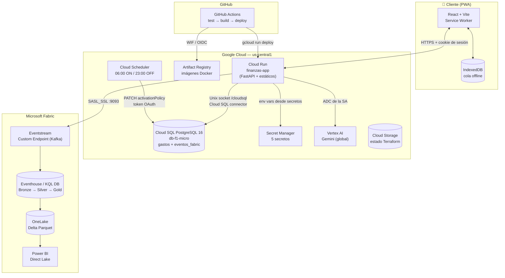
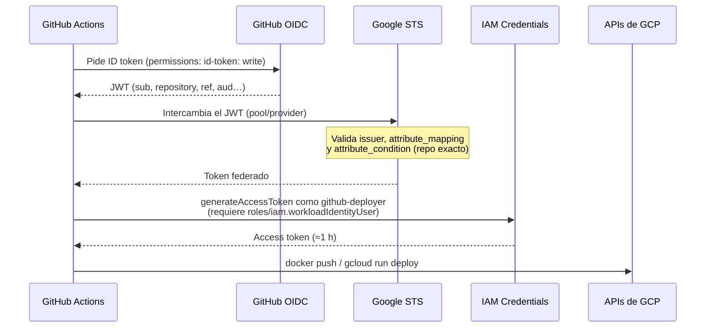
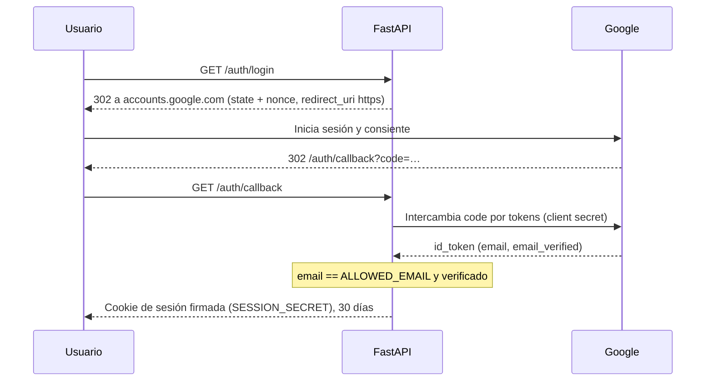
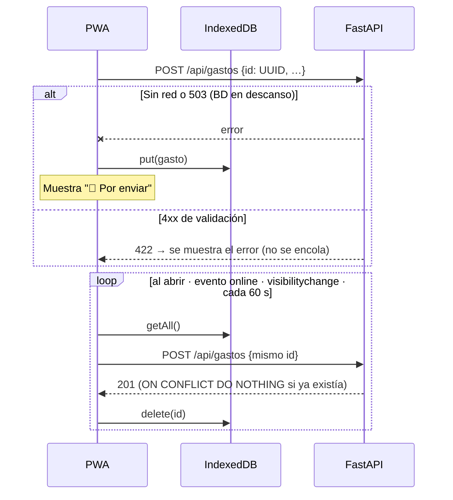
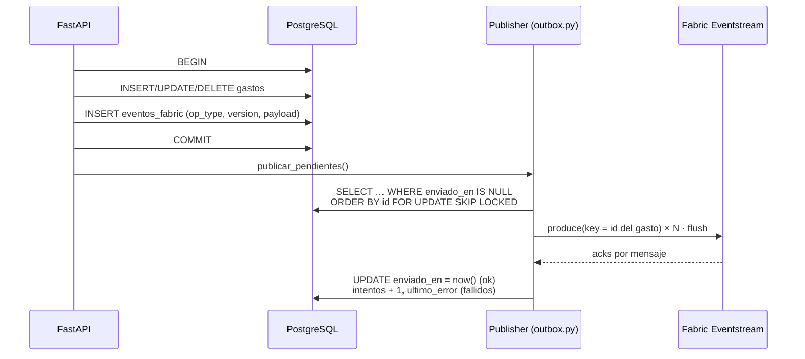
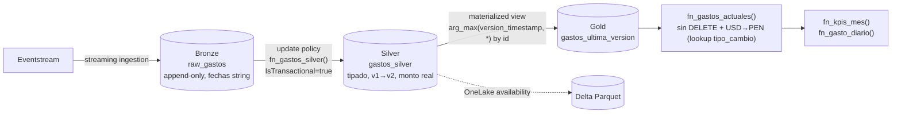
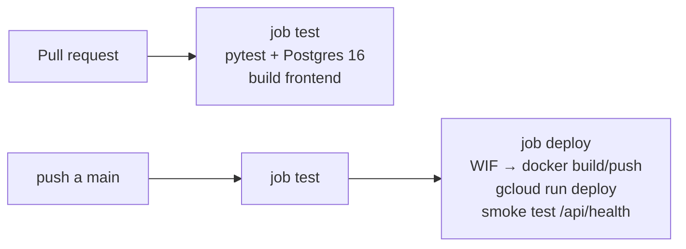

# Documentación técnica — Mis Gastos

> Documento de arquitectura, decisiones de diseño y **guía de estudio**. Cada sección explica *qué* se usó, *cómo* está
> configurado en este repositorio y *por qué*. Los recuadros **📘 Para el examen** resumen los conceptos que suelen
> preguntarse en certificaciones; la [sección 13](#13-mapa-de-certificaciones) los cruza con cada examen y la
> [sección 14](#14-preguntas-de-repaso) trae preguntas de práctica con respuesta.

## Índice
1. [Visión general](#1-visión-general)
2. [Mapa de herramientas](#2-mapa-de-herramientas)
3. [Google Cloud: cómputo y datos](#3-google-cloud-cómputo-y-datos)
4. [Google Cloud: identidad, seguridad y secretos](#4-google-cloud-identidad-seguridad-y-secretos)
5. [FinOps: automatización de costos](#5-finops-automatización-de-costos)
6. [Infraestructura como código (Terraform)](#6-infraestructura-como-código-terraform)
7. [Aplicación: backend FastAPI](#7-aplicación-backend-fastapi)
8. [Aplicación: frontend React + PWA](#8-aplicación-frontend-react--pwa)
9. [IA generativa con Gemini (Vertex AI)](#9-ia-generativa-con-gemini-vertex-ai)
10. [Streaming: Transactional Outbox → Kafka → Fabric](#10-streaming-transactional-outbox--kafka--fabric)
11. [Microsoft Fabric: Real-Time Intelligence y Medallion](#11-microsoft-fabric-real-time-intelligence-y-medallion)
12. [CI/CD, entornos y calidad](#12-cicd-entornos-y-calidad)
13. [Mapa de certificaciones](#13-mapa-de-certificaciones)
14. [Preguntas de repaso](#14-preguntas-de-repaso)
15. [Lecciones aprendidas (incidentes reales)](#15-lecciones-aprendidas-incidentes-reales)
16. [Glosario](#16-glosario)

---

## 1. Visión general

### 1.1 Requisitos que guiaron el diseño
| Requisito | Tipo | Consecuencia en la arquitectura |
|---|---|---|
| Un solo usuario, acceso restringido | Seguridad | Google OAuth + lista blanca de un correo (`ALLOWED_EMAIL`) |
| Costo mínimo | FinOps | Serverless que escala a cero, BD pequeña **apagada de noche** |
| Ningún gasto se pierde | Confiabilidad | PostgreSQL como fuente de verdad + **outbox transaccional** + **cola offline** en el teléfono |
| Analítica en tiempo real | Datos | Eventos a **Microsoft Fabric** (Eventstream → Eventhouse KQL) |
| Editar/borrar sin "datos fantasma" en analítica | Datos | Eventos **CDC** con `op_type` + `version` y deduplicación `arg_max` |
| Sin secretos en el código ni llaves JSON | Seguridad | Secret Manager + **Workload Identity Federation** |
| Reproducible | Operación | Todo en **Terraform** + **GitHub Actions** |

### 1.2 Diagrama de arquitectura



### 1.3 Flujo de un gasto, de punta a punta
1. El usuario completa el formulario en la PWA. El cliente genera el **UUID** del gasto.
2. `POST /api/gastos` → FastAPI valida con Pydantic.
3. En **una transacción** de PostgreSQL: `INSERT` en `gastos` + `INSERT` del evento en `eventos_fabric` (outbox).
4. Tras el commit, el **publisher** envía los eventos pendientes al Eventstream (protocolo Kafka) y marca `enviado_en`.
5. El Eventstream ingiere por streaming en la tabla **Bronze** `raw_gastos` del Eventhouse.
6. Una **update policy** transforma cada lote a **Silver** (`gastos_silver`) en la misma transacción de ingesta.
7. Una **vista materializada** mantiene la última versión de cada gasto (**Gold**), y OneLake expone Silver como Delta para Power BI.
8. Si en el paso 2 no hay red o la BD está apagada (503), el gasto queda en **IndexedDB** y se reintenta solo (idempotente por UUID).

---

## 2. Mapa de herramientas

| Capa | Herramienta / servicio | Rol en el proyecto | Alternativas consideradas | Por qué se eligió |
|---|---|---|---|---|
| Cómputo | **Cloud Run** (v2) | Sirve API + frontend en un contenedor | GKE, App Engine, Cloud Functions | Escala a cero, cobro por request, contenedor estándar, revisiones |
| Base de datos | **Cloud SQL for PostgreSQL 16** | Fuente de verdad (OLTP) | Firestore, AlloyDB, Spanner | Relacional/transaccional (necesario para outbox), barato en `db-f1-micro` |
| Conexión a BD | **Cloud SQL connector** (volumen `/cloudsql`) | Conexión cifrada y autorizada por IAM | IP privada + VPC, IP autorizada | Sin VPC ni redes autorizadas; TLS e IAM automáticos |
| Secretos | **Secret Manager** | Cadena de BD, OAuth, Fabric, sesión | Variables en texto plano, Vault | Nativo, versionado, IAM por secreto |
| Registro de imágenes | **Artifact Registry** | Imágenes Docker | Container Registry (deprecado), Docker Hub | Regional, IAM, políticas de limpieza |
| Programación | **Cloud Scheduler** | Encender/apagar Cloud SQL | Cloud Functions + cron, Workflows | Llama directo a la API REST con token OAuth, sin código |
| IA | **Vertex AI – Gemini** (`google-genai`) | OCR semántico de vouchers y consejos | Document AI, Vision API, OpenAI | Multimodal, salida JSON con esquema, auth con la SA (sin API key) |
| IaC | **Terraform** + provider `google` 6.x | Toda la infraestructura GCP | gcloud scripts, Pulumi, Deployment Manager | Declarativo, plan revisable, estado remoto |
| Estado IaC | **GCS backend** | `tfstate` remoto versionado | Terraform Cloud, estado local | Bloqueo nativo, versionado, $≈0 |
| CI/CD | **GitHub Actions** | Tests, build, deploy | Cloud Build | Integrado al repo; WIF elimina llaves |
| Identidad CI | **Workload Identity Federation** | GitHub → GCP sin llaves JSON | Llave JSON de SA | Credenciales efímeras, sin secretos de larga vida |
| Backend | **FastAPI** + Pydantic v2 + Uvicorn | API REST, validación, OAuth | Django, Flask, Express | Tipado, validación automática, rápido |
| Driver BD | **psycopg 3** + `psycopg_pool` | Pool de conexiones síncrono | SQLAlchemy, asyncpg | Simple, transacciones explícitas, JSONB |
| Auth | **Authlib** (OpenID Connect con Google) | Login | Firebase Auth, IAP | Control total del callback y de la lista blanca |
| Frontend | **React 18** + **Vite 5** | UI | Next.js, Vue | SPA ligera servida por el mismo contenedor |
| PWA | **vite-plugin-pwa** (Workbox) | Instalable, app shell offline | Service worker manual | Precache con hash, aviso de actualización |
| Offline | **IndexedDB** | Cola de gastos pendientes | localStorage | Asíncrono, estructurado, mayor capacidad |
| Mensajería | **Protocolo Apache Kafka** sobre Event Hubs | Transporte de eventos a Fabric | HTTP directo, AMQP | El Custom Endpoint de Fabric expone Kafka; librería madura |
| Cliente Kafka | **confluent-kafka** (librdkafka) | Productor | kafka-python, azure-eventhub | Rendimiento, confirmaciones por mensaje |
| Streaming/analítica | **Fabric Eventstream** | Ingesta de eventos | Event Hubs + ADX | Integrado con Eventhouse y OneLake |
| Base analítica | **Fabric Eventhouse (KQL DB)** | Bronze/Silver/Gold, consultas en tiempo real | Lakehouse + Spark, Warehouse | Latencia de segundos, update policies, KQL |
| Almacenamiento abierto | **OneLake (Delta Parquet)** | Gold consumible por Power BI/Spark | Exportación manual | "OneLake availability" sin pipelines extra |
| Pruebas | **pytest** + PostgreSQL 16 (service container) | Tests de integración reales | SQLite, mocks | Se prueba el SQL real (FILTER, JSONB, SKIP LOCKED) |

---

## 3. Google Cloud: cómputo y datos

### 3.1 Cloud Run (`infra-gcp/cloudrun.tf`)
**Qué es:** plataforma serverless que ejecuta contenedores sin estado; escala por número de requests.

**Configuración en este proyecto:**
| Parámetro | Valor | Por qué |
|---|---|---|
| `min_instance_count` / `max_instance_count` | 0 / 2 | Escala a cero (sin costo en reposo); tope para controlar gasto |
| `cpu_idle = true` | CPU solo durante requests | Facturación "por request" (más barata); el trabajo en segundo plano tras responder puede quedar sin CPU |
| `limits` | 1 vCPU / 512 MiB | Suficiente para FastAPI + librdkafka |
| `ingress` | `INGRESS_TRAFFIC_ALL` | Accesible desde internet; la autorización la hace la app |
| Invoker | `allUsers` → `roles/run.invoker` | Servicio público; el login de Google filtra el acceso |
| Volumen `cloud_sql_instance` | `/cloudsql/<connection_name>` | El connector crea el socket Unix con TLS e IAM |
| Variables de entorno | Valores literales + `secret_key_ref` (`latest`) | Los secretos se leen **al iniciar cada instancia** |
| `lifecycle.ignore_changes` | `image`, `scaling`, `client` | La imagen la despliega CI; Terraform no la revierte |

**Revisiones:** cada cambio de plantilla (imagen, variables, secretos) crea una **revisión inmutable** (`finanzas-app-0000N`). El tráfico pasa a la nueva revisión solo si arranca y responde en el puerto (`$PORT`, 8080).

> 📘 **Para el examen**
> - Cloud Run escala a cero; **min instances > 0** elimina el arranque en frío pero cobra en reposo.
> - **CPU always allocated** vs **CPU only during requests** (`cpu_idle`): solo la primera permite trabajo en segundo plano confiable.
> - Un secreto montado como variable de entorno con versión `latest` se resuelve **al iniciar la instancia**: para usar un valor rotado hace falta una **nueva revisión** (aquí se fuerza cambiando `FABRIC_ENTORNO`).
> - Rutas terminadas en `z` como `/healthz` están **reservadas** por el frontend de Google: usar `/api/health`.
> - Concurrencia por defecto: 80 requests por instancia.

### 3.2 Cloud SQL for PostgreSQL (`infra-gcp/cloudsql.tf`)
| Parámetro | Valor | Explicación |
|---|---|---|
| Versión | `POSTGRES_16` | |
| Edición | `ENTERPRISE` | `db-f1-micro` (shared-core) **solo existe en Enterprise**; Enterprise Plus usa tiers dedicados |
| Tier | `db-f1-micro` | Núcleo compartido, 0.6 GB RAM. **Sin SLA** (los shared-core no están cubiertos) |
| Disponibilidad | `ZONAL` | Sin réplica HA (la HA regional duplicaría el costo) |
| Disco | 10 GB `PD_HDD`, sin autoresize | HDD es más barato; el volumen de datos es mínimo |
| Red | IP pública **sin redes autorizadas** + `ssl_mode = ENCRYPTED_ONLY` | Nadie entra por IP; solo vía connector (IAM + TLS) |
| Backups | Diarios a las 18:00 UTC (13:00 Lima), 7 retenidos, sin PITR | La ventana debe caer **cuando la instancia está encendida** |
| Mantenimiento | Domingo 14:00 UTC (09:00 Lima) | Misma razón |
| `activation_policy` | `ALWAYS`/`NEVER` (lo cambia Scheduler) | `lifecycle.ignore_changes` evita que Terraform la revierta |
| `deletion_protection` | `true` | Evita borrados accidentales con `terraform destroy` |

**Esquema (`app/backend/db.py`):**
- `gastos`: el modelo de dominio + columnas v2 `monto_propio`, `liquidado`, `version`, `actualizado_en`.
  Restricciones `CHECK` replican los enums de la API (defensa en profundidad).
- `eventos_fabric`: la **outbox** (`op_type`, `version`, `payload JSONB`, `enviado_en`, `intentos`, `ultimo_error`) con
  un **índice parcial** `WHERE enviado_en IS NULL` para que buscar pendientes sea O(pendientes).
- La migración es **idempotente** (`CREATE … IF NOT EXISTS`, `ADD COLUMN IF NOT EXISTS`) y se serializa entre instancias
  con `pg_advisory_xact_lock`.

**KPIs exactos en SQL:** "gasto real" = `COALESCE(monto_propio, monto_total)`; los KPIs del mes usan
`SUM(...) FILTER (WHERE ...)` y el mes en hora de Lima: `date_trunc('month', (now() AT TIME ZONE 'America/Lima')::date)`.

> 📘 **Para el examen**
> - Formas de conectar a Cloud SQL: **Cloud SQL Auth Proxy / connectors** (recomendado: IAM + TLS sin gestionar certificados), IP privada (VPC / Private Service Access), IP pública con redes autorizadas.
> - El rol mínimo para conectarse vía connector es **`roles/cloudsql.client`**.
> - **Shared-core (`db-f1-micro`, `db-g1-small`) no tiene SLA**; no usar en producción crítica.
> - Una instancia detenida (`activationPolicy = NEVER`) **sigue cobrando almacenamiento** e IP, pero no CPU/RAM.
> - HA = instancia primaria + standby en otra zona con disco regional; las réplicas de lectura no son HA.

### 3.3 Artifact Registry (`infra-gcp/artifact_registry.tf`)
Repositorio Docker regional `finanzas`. Políticas de limpieza:
- `KEEP` las **5 versiones más recientes**;
- `DELETE` lo que tenga más de 7 días **y no esté protegido por KEEP** (KEEP tiene precedencia).

> 📘 **Para el examen:** Container Registry está deprecado → Artifact Registry. Las *cleanup policies* evalúan KEEP antes que DELETE y pueden probarse con `cleanup_policy_dry_run`.

---

## 4. Google Cloud: identidad, seguridad y secretos

### 4.1 Service Accounts y mínimo privilegio
| Service Account | Uso | Roles | Alcance |
|---|---|---|---|
| `finanzas-run` | Identidad de Cloud Run | `cloudsql.client`, `aiplatform.user`, `secretmanager.secretAccessor` | `cloudsql.client` **con condición IAM** a la instancia; secretos **por secreto** |
| `sql-scheduler` | Llamar a la API de Cloud SQL | `cloudsql.editor` | **Condición IAM** → solo `finanzas-pg` |
| `github-deployer` | CI/CD | `artifactregistry.writer` (en el repo), `run.developer` (en el servicio), `iam.serviceAccountUser` (sobre `finanzas-run`) | Recurso, no proyecto |

**Condiciones IAM (IAM Conditions)** — el proyecto es compartido, así que los roles de Cloud SQL a nivel proyecto se acotan:
```hcl
condition {
  title      = "solo-finanzas-pg"
  expression = "resource.type == \"sqladmin.googleapis.com/Instance\" && resource.name == \"projects/<PROYECTO>/instances/finanzas-pg\""
}
```

> 📘 **Para el examen**
> - Jerarquía de herencia IAM: organización → carpeta → proyecto → recurso; los permisos se **suman**, salvo *deny policies*.
> - Para desplegar Cloud Run con una SA de runtime distinta, quien despliega necesita **`iam.serviceAccountUser`** sobre esa SA ("actAs").
> - Las condiciones IAM usan **CEL** sobre atributos como `resource.name`, `resource.type` y `request.time`.
> - Rol básico (Owner/Editor) < rol predefinido < rol personalizado, en precisión. Evitar roles básicos.

### 4.2 Secret Manager (`infra-gcp/secrets.tf`)
Cinco secretos: `database-url`, `session-secret`, `fabric-eventstream-connection-string`, `google-oauth-client-id`, `google-oauth-client-secret`.
- Las **versiones son inmutables**; rotar = crear una versión nueva (Terraform la reemplaza cuando cambia el valor).
- Replicación **automática** (Google elige las regiones).
- Si un valor externo aún no existe, se guarda `PENDIENTE` para que el primer `apply` no falle (resuelve el huevo-y-la-gallina del redirect URI de OAuth, que depende de la URL de Cloud Run).
- `random_password` genera la contraseña de BD y el secreto de sesión: **quedan en el tfstate**, por eso el estado es remoto, privado y versionado.

### 4.3 Workload Identity Federation (`infra-gcp/github_wif.tf`)
Permite que GitHub Actions obtenga **credenciales de GCP de corta duración** sin llaves JSON.



Piezas: **pool** `github-pool` → **provider** OIDC `https://token.actions.githubusercontent.com` con
`attribute_mapping` (`google.subject`, `attribute.repository`, `attribute.ref`) y
`attribute_condition = "assertion.repository == '<owner>/<repo>'"` → binding
`principalSet://iam.googleapis.com/<pool>/attribute.repository/<owner>/<repo>` con `roles/iam.workloadIdentityUser`.

> 📘 **Para el examen:** WIF reemplaza las llaves de SA (riesgo de filtración, rotación manual). La `attribute_condition` es obligatoria en providers nuevos y es la barrera que impide que **cualquier** repo de GitHub use tu pool. Los pools borrados quedan en *soft delete* 30 días (el ID no se puede reutilizar en ese lapso).

### 4.4 Autenticación de la app (Google OAuth / OpenID Connect)

- Uvicorn corre con `--proxy-headers` para que `request.url_for` genere **https** detrás del balanceador de Cloud Run (si no, el `redirect_uri` sería `http` y Google lo rechaza).
- Cookie `https_only`, `same_site=lax`. Cualquier otro correo → sesión limpiada y redirección con `?error=denegado`.

### 4.5 Modelo de amenazas (resumen)
| Amenaza | Mitigación |
|---|---|
| Acceso de terceros a la app | OAuth + lista blanca de un correo verificado |
| Robo de credenciales de BD | BD sin redes autorizadas; acceso solo vía connector con IAM; contraseña en Secret Manager |
| Llaves de SA filtradas en CI | No existen: WIF |
| Escalada en proyecto compartido | Condiciones IAM a la instancia; roles a nivel recurso |
| Secretos en el repo | `.gitignore` de `tfvars`/`tfstate`/`tfplan`; escaneo antes de publicar |
| Datos financieros servidos desde caché | Service worker con `/api/*` en **NetworkOnly** |
| Envío de datos personales a la IA | Consejos con **agregados**; nunca filas individuales |
| Path traversal en estáticos | Lista blanca de archivos raíz + `os.path.basename` |

---

## 5. FinOps: automatización de costos

### 5.1 Encendido/apagado de Cloud SQL (`infra-gcp/scheduler.tf`)
Dos jobs de **Cloud Scheduler** (zona `America/Lima`) hacen `PATCH https://sqladmin.googleapis.com/v1/projects/<P>/instances/finanzas-pg` con el cuerpo:
```json
{"settings": {"activationPolicy": "ALWAYS"}}   // 06:00
{"settings": {"activationPolicy": "NEVER"}}    // 23:00
```
Se autentican con un **token OAuth** de la SA `sql-scheduler` (scope `cloud-platform`).

> 📘 **Para el examen — OAuth vs OIDC en Cloud Scheduler / Pub/Sub push / Cloud Tasks**
> - **OAuth access token** → para llamar **APIs de Google** (`*.googleapis.com`).
> - **OIDC ID token** → para llamar **servicios propios** que validan identidad (Cloud Run, Cloud Functions, endpoints detrás de IAP).

### 5.2 Estimación de costos (us-central1, aproximada)
| Recurso | Costo mensual aprox. | Palanca de ahorro aplicada |
|---|---|---|
| Cloud SQL `db-f1-micro` (17 h/día) | US$ 5–7 | Apagado nocturno (−29 %) |
| Disco 10 GB HDD + backups | US$ 1–2 | HDD, 7 backups |
| Cloud Run | ≈ US$ 0 | Escala a cero, CPU solo en requests, capa gratuita |
| Secret Manager (5 secretos) | ≈ US$ 0.30 | — |
| Artifact Registry | ≈ US$ 0.10 | Política de limpieza |
| Cloud Scheduler (2 jobs) | US$ 0 | 3 jobs gratis por cuenta de facturación |
| Vertex AI Gemini Flash | céntimos | Modelo Flash, imágenes reducidas a 1600 px |
| Bucket de estado | ≈ US$ 0 | Solo 10 versiones antiguas |

---

## 6. Infraestructura como código (Terraform)

### 6.1 Organización de `infra-gcp/`
| Archivo | Contenido |
|---|---|
| `versions.tf` | Versiones de Terraform y providers (`google ~> 6.0`, `random ~> 3.6`), backend GCS |
| `variables.tf` | Entradas con validaciones (`fabric_entorno ∈ {prd,test}`) y `sensitive` para secretos |
| `apis.tf` | `google_project_service` con `for_each` y `disable_on_destroy = false` |
| `cloudsql.tf`, `cloudrun.tf`, `scheduler.tf`, `secrets.tf`, `artifact_registry.tf`, `github_wif.tf` | Un archivo por dominio |
| `state_bucket.tf` | Bucket del estado (versionado, `public_access_prevention = enforced`, `prevent_destroy`) |
| `outputs.tf` | URL, redirect URI de OAuth, valores para las variables de GitHub |

### 6.2 Patrones usados
- **`for_each` sobre mapas/sets** (`google_secret_manager_secret.app`, `google_cloud_scheduler_job.sql`). Para iterar sobre claves de un mapa con valores sensibles: `nonsensitive(toset(keys(local.secrets)))`.
- **`dynamic "env"`** en Cloud Run para generar una variable por secreto.
- **`depends_on`** explícito hacia la activación de APIs (dependencias que Terraform no puede inferir).
- **`lifecycle`**: `ignore_changes` (campos gestionados fuera de Terraform), `prevent_destroy` (bucket de estado), y `deletion_protection` del recurso (Cloud SQL).
- **`coalesce(var.x, "PENDIENTE")`** para valores opcionales.
- **Plan guardado** (`terraform plan -out=tfplan` → `terraform apply tfplan`): lo que se aprueba es exactamente lo que se aplica.

### 6.3 Estado remoto y migración
1. El bucket se crea **con estado local** (bootstrap).
2. Se agrega `backend "gcs"` y se ejecuta `terraform init -migrate-state` (respaldo previo del `tfstate`).
3. Verificación: `terraform plan` → *No changes*.

El backend GCS soporta **bloqueo de estado** nativo (evita dos `apply` simultáneos) y, con versionado del bucket, permite recuperar un estado anterior.

> 📘 **Para el examen (Terraform Associate)**
> - `terraform init` (providers/backend) → `validate` → `plan` → `apply`; `fmt` para estilo; `state list/mv/rm` y `import` para gestionar estado.
> - El estado puede contener **secretos en texto plano**: backend remoto con cifrado y control de acceso.
> - `-migrate-state` copia el estado al cambiar de backend; `-reconfigure` lo ignora.
> - `ignore_changes` evita *drift* esperado; `prevent_destroy` aborta un plan que destruiría el recurso.
> - `sensitive = true` oculta valores en la salida del plan, **no** en el estado.
> - Un **plan guardado** captura valores del momento: si la infraestructura cambió después (por ejemplo, CI desplegó otra imagen), aplicarlo puede revertir ese cambio (ver [lección 15.5](#155-plan-guardado-y-despliegues-concurrentes)).

---

## 7. Aplicación: backend FastAPI

### 7.1 Módulos (`app/backend/`)
| Módulo | Responsabilidad |
|---|---|
| `main.py` | Rutas, modelos Pydantic, OAuth, manejadores de error, servir SPA/PWA |
| `db.py` | Pool, migración, escrituras con outbox, lecturas/KPIs |
| `outbox.py` | Publisher de eventos pendientes (auto-retry) |
| `fabric.py` | Productor Kafka hacia el Eventstream |
| `ia.py` | Gemini: escaneo de imágenes y consejos |
| `config.py` | Variables de entorno y zona horaria |

### 7.2 API
| Método y ruta | Descripción |
|---|---|
| `GET /api/health` | Health check (sin auth) |
| `GET /api/me` | Usuario de la sesión |
| `GET /api/gastos` | Últimos 50 gastos (+ `fabric_pendiente`); dispara publicación en segundo plano si hay pendientes |
| `POST /api/gastos` | Crea un gasto; **idempotente por `id`** (`ON CONFLICT DO NOTHING`) |
| `PUT /api/gastos/{id}` | Edita; `version + 1` y evento `UPDATE` |
| `DELETE /api/gastos/{id}` | Borra; evento `DELETE` con el último estado |
| `GET /api/kpis/mes` | KPIs exactos del mes (PEN/USD) calculados en SQL |
| `GET /api/por-cobrar` · `POST /api/gastos/{id}/liquidar` | Compartidos pendientes / marcar cobrado |
| `GET /api/resumen?dias=` | Agregados por categoría, tipo, método, mes y top hormiga |
| `POST /api/ia/escanear` · `POST /api/ia/consejos` | Gemini |
| `POST /api/fabric/reenviar` | Publicación manual de la outbox |

### 7.3 Decisiones de diseño
- **Rutas síncronas (`def`)**: psycopg, confluent-kafka y google-genai son bloqueantes; FastAPI ejecuta las rutas `def` en un *threadpool*. Las únicas `async` son las de Authlib (OAuth).
- **Errores de dominio → códigos HTTP**: BD apagada → **503** con `codigo: bd_descanso` (la PWA lo usa para encolar); fallo de IA → **502**.
- **Validación en dos capas**: Pydantic (`Literal`, `Decimal` con `max_digits`/`decimal_places`, `model_validator` para el split) + `CHECK` en PostgreSQL.
- **Pool perezoso** (`min_size=0`, `open(wait=False)`): la app arranca aunque la BD esté apagada.
- **Fechas "de hoy" siempre en `America/Lima`** (el contenedor está en UTC).

### 7.4 Pruebas (`app/backend/tests/`)
17 pruebas de integración con **PostgreSQL 16 real** (service container de GitHub Actions): KPIs con 60 gastos (regresión del bug "últimos 50"), idempotencia, versionado CDC, split 50/50, liquidación, reintentos de la outbox con fallos simulados, enums inválidos, rutas desconocidas. La autenticación se sustituye con `app.dependency_overrides`.

---

## 8. Aplicación: frontend React + PWA

### 8.1 Estructura (`app/frontend/src/`)
`App.jsx` (shell, navegación, sincronización), `Formulario.jsx` (registro/edición), `PorCobrar.jsx`, `Resumen.jsx`, `Tutorial.jsx`, `Sheet.jsx` (bottom sheet), `cola.js` (IndexedDB), `lib.js` (API, formatos, categorías), `iconos.jsx`, `styles.css` (tokens de diseño claro/oscuro).

### 8.2 Diseño de interacción
- **Registro rápido en línea** como acción principal; el escaneo es secundario.
- **Defaults = respuesta más común**: último método de pago, banco y moneda (localStorage); tipo de gasto inferido por categoría.
- Opcionales plegados ("Más opciones"); **errores bajo cada campo** con `aria-invalid` y `aria-describedby`.
- Regla verificable: en 390×844, **Guardar visible sin scroll**.
- Base móvil: inputs de 16 px (evita zoom en iOS), `touch-action: manipulation`, `env(safe-area-inset-*)`, `100dvh`, `theme-color` por esquema, `:hover` solo con `(hover: hover) and (pointer: fine)`.

### 8.3 PWA (`vite.config.js`)
| Recurso | Estrategia Workbox | Motivo |
|---|---|---|
| App shell (`index.html`, `/assets/*` con hash) | **Precache** | Abre sin red |
| Fuentes de Google | **CacheFirst** con expiración | Estáticas |
| `/api/*`, `/auth/*` | **NetworkOnly** | Datos financieros y sesión nunca desde caché |

`registerType: "prompt"`: al detectar una versión nueva se muestra un aviso con **Actualizar**, en lugar de actualizar en silencio.
El backend sirve `sw.js` con `Cache-Control: no-cache` (si no, el navegador podría no ver versiones nuevas).

### 8.4 Cola offline (`cola.js`)

No se usa la Background Sync API porque **iOS no la soporta**.

---

## 9. IA generativa con Gemini (Vertex AI)

- SDK **`google-genai`** con `vertexai=True`, región **`global`** y modelo configurable (`GEMINI_MODEL`, hoy `gemini-3-flash-preview`).
- Autenticación con **Application Default Credentials** de la SA de Cloud Run (`roles/aiplatform.user`): sin API keys.
- **Salida estructurada**: `response_mime_type="application/json"` + `response_schema` (modelo Pydantic). El backend **normaliza** igual los valores (enums válidos, fechas `YYYY-MM-DD` o `DD/MM/YYYY`, no futuras) porque el modelo puede desviarse.
- **Escaneo** (temperatura 0.1): la imagen se reduce en el cliente a 1600 px JPEG; el prompt incluye reglas locales (S/ = PEN, "CREDITO" → TC, definición de gasto hormiga). Nunca guarda: prellena el formulario.
- **Consejos** (temperatura 0.4): reciben solo **agregados** del período (minimización de datos).

> 📘 **Para el examen:** structured output reduce el parsing frágil; temperatura baja = respuestas más deterministas (extracción), más alta = más variadas (redacción). Los endpoints `global` dan mayor disponibilidad de modelos; los regionales, residencia de datos.

---

## 10. Streaming: Transactional Outbox → Kafka → Fabric

### 10.1 El problema del *dual write*
Escribir en la BD **y** en Kafka desde la misma operación sin coordinación produce inconsistencias:
si Kafka falla después del commit, el evento se pierde; si se publica antes y la BD falla, hay un evento fantasma.

### 10.2 Patrón Transactional Outbox

- **Atomicidad:** el cambio y su evento existen juntos o no existen.
- **Auto-retry:** tras cada escritura, en segundo plano al listar y con un botón manual.
- **Concurrencia:** `FOR UPDATE SKIP LOCKED` permite varias instancias sin enviar dos veces el mismo lote; un `threading.Lock` evita publicadores simultáneos dentro de una instancia.
- **Semántica de entrega: *at-least-once*** (si el `UPDATE enviado_en` falla tras el envío, se reenvía). Por eso el consumidor **deduplica**.

**¿Por qué outbox y no CDC por replicación lógica (Debezium, Datastream)?** La instancia se apaga de noche,
`db-f1-micro` no justifica un conector permanente y el volumen es mínimo. El outbox da CDC "a nivel de aplicación" sin infraestructura extra.

### 10.3 Contrato de evento (v2)
```json
{
  "id": "2940d927-…",              // UUID del gasto (clave de partición)
  "op_type": "INSERT",             // INSERT | UPDATE | DELETE
  "version": 1,                    // crece con cada cambio del gasto
  "version_timestamp": "2026-11-08T07:12:12-05:00",
  "schema_version": 2,
  "fecha_registro": "…", "fecha_gasto": "2026-11-08",
  "categoria": "Alimentación", "concepto": "…", "tipo_gasto": "Variable Necesario",
  "metodo_pago": "Yape-Plin", "entidad_financiera": "", "moneda": "PEN",
  "cantidad": 1.0, "monto_total": 4.0, "monto_propio": null,
  "es_compartido": false, "liquidado": false
}
```
Cambios aditivos (campos opcionales) mantienen `schema_version`; los cambios que rompen lo incrementan. Los eventos v1 (sin `op_type`) siguen siendo válidos: Silver los normaliza como `INSERT` versión 1.

### 10.4 Kafka sobre el Custom Endpoint de Fabric (Event Hubs)
| Parámetro de librdkafka | Valor |
|---|---|
| `bootstrap.servers` | `<namespace>.servicebus.windows.net:9093` |
| `security.protocol` / `sasl.mechanism` | `SASL_SSL` / `PLAIN` |
| `sasl.username` / `sasl.password` | `$ConnectionString` / la cadena de conexión completa |
| Topic | `EntityPath` de la cadena |
| `acks` | `all` |
| Clave del mensaje | `id` del gasto → misma partición → **orden garantizado por gasto** |

> 📘 **Para el examen**
> - Kafka garantiza orden **dentro de una partición**, no entre particiones: la clave define la partición.
> - Semánticas: *at-most-once*, *at-least-once* (la más común) y *exactly-once* (requiere idempotencia y transacciones extremo a extremo).
> - Event Hubs ≈ Kafka: namespace ≈ cluster, event hub ≈ topic, consumer group ≈ consumer group.

---

## 11. Microsoft Fabric: Real-Time Intelligence y Medallion

### 11.1 Componentes
| Ítem | Rol |
|---|---|
| **Workspace** | Contenedor de ítems con roles (Admin/Member/Contributor/Viewer), asignado a una **capacidad** (aquí Trial) |
| **Eventstream** | Ingesta y enrutamiento en tiempo real. Fuente **Custom Endpoint** (Kafka/AMQP/Event Hubs) → destino Eventhouse |
| **Eventhouse** | Motor de Real-Time Intelligence (Kusto); contiene **KQL Databases** |
| **KQL Database** | Tablas, funciones, update policies y vistas materializadas |
| **OneLake availability** | Exporta tablas KQL a OneLake como **Delta Parquet** (consumibles por Lakehouse, Spark, Power BI Direct Lake) |

**Modos de ingesta del destino Eventhouse en Eventstream:**
- *Direct ingestion*: el Eventhouse lee del stream con su propio mapping.
- ***Event processing before ingestion*** (**usado aquí**, `ProcessedIngestion`): el Eventstream procesa y escribe columnas por nombre de campo JSON, más columnas de sistema `EventProcessedUtcTime`, `PartitionId` y `EventEnqueuedUtcTime`. Los campos nuevos se mapean solos si la tabla tiene la columna.

### 11.2 Arquitectura Medallion en KQL (`fabric/kql/`)


| Capa | Objeto | Reglas de calidad |
|---|---|---|
| Bronze | `raw_gastos` | Tal cual llega; retención 10 años; **no se transforma** |
| Silver | `gastos_silver` + `fn_gastos_silver()` | Descarta filas sin `id`; normaliza `op_type`, `version`; tipa fechas; calcula `monto_real` y `por_cobrar` |
| Gold | `gastos_ultima_version` (MV) | Última versión por `id` (resuelve duplicados *at-least-once* y desorden); excluye `DELETE` |
| Consumo | `fn_gastos_actuales`, `fn_kpis_mes`, `fn_gasto_diario` | Conversión a PEN con `tipo_cambio`; anomalías con media móvil 30 d (`make-series` + `series_fir`) |

**Deduplicación CDC** (la idea central):
```kql
gastos_silver
| summarize arg_max(version_timestamp, *) by id   // la última versión gana
| where op_type != "DELETE"                       // los borrados desaparecen
```

**Scripts idempotentes** (se re-ejecutan en TEST y PRD sin efectos secundarios):
`.create-merge table`, `.create-or-alter function`, `.alter table … policy update`,
`.create ifnotexists materialized-view … with (backfill = true)`, y `.set-or-append … | where toscalar(T | count) == 0` para semillas y backfills de una sola vez.

> 📘 **Para el examen (DP-700)**
> - **Update policy**: transforma datos de una tabla fuente al ingerirlos; con `IsTransactional = true`, si la transformación falla también falla la ingesta en la fuente (no hay pérdida silenciosa).
> - **Con streaming ingestion en la tabla fuente, la consulta de la update policy no puede referenciar otras tablas** (join/lookup) **ni usar `ingestion_time()`** (ver [lección 15.6](#156-update-policy-con-ingesta-streaming)).
> - El esquema de salida de la función debe coincidir **exactamente** (orden y tipos) con la tabla destino.
> - **Vistas materializadas**: `arg_max`/`take_any`/`count`… mantenidos de forma incremental; `backfill=true` solo al crear. Consultar por nombre combina lo materializado con el delta; `materialized_view('x')` devuelve **solo** la parte materializada (más rápida, posiblemente desactualizada).
> - Políticas: **retention** (cuánto se guarda), **caching** (cuánto está en caché caliente), **streaming ingestion** (latencia < 1 s), **mirroring** (OneLake availability).
> - KQL: filtrar temprano por tiempo, `project` lo necesario, `summarize` en el servidor, `bin()` para series, `take` para explorar.

### 11.3 Entornos TEST y PRD
| | TEST (`test_wt`) | PRD (`finanzas-prd`) |
|---|---|---|
| Datos | Pruebas y eventos sintéticos | Cloud Run producción (`FABRIC_ENTORNO=prd`) |
| Cambios | En el portal | Solo por pipeline (CI/CD) |

PRD se creó por **API REST de Fabric** (`POST /v1/workspaces`, `/eventhouses`, `/eventstreams` con definición en base64 clonada de TEST mediante `getDefinition`) y los scripts KQL se aplicaron por la API de Kusto (`POST {queryUri}/v1/rest/mgmt`).
La cadena del Custom Endpoint de PRD se obtuvo con `GET …/eventstreams/{id}/sources/{sourceId}/connection` y se guardó en Secret Manager vía Terraform.

**Opciones de CI/CD en Fabric:**
| Mecanismo | Qué hace | Cuándo |
|---|---|---|
| **Git integration** | Sincroniza un workspace con una rama (Azure DevOps o GitHub) | Desarrollo y versionado de ítems |
| **Deployment pipelines** | Promueve contenido Dev → Test → Prod en el portal, con reglas por etapa | Equipos sin pipeline de código |
| **`fabric-cicd`** (Python) + service principal | Despliega desde el repo con parametrización (`parameter.yml`) | Automatización completa desde GitHub Actions |

**Implementación actual (sin service principal):** registrar apps en el tenant corporativo requiere permisos de directorio
("Insufficient privileges"). Mientras tanto:
- KQL: `fabric/scripts/desplegar_kql.ps1 -Entorno test|prd` con la sesión `az` del desarrollador (idempotente, con confirmación para PRD).
- Ítems: Git integration (credencial de usuario + token de GitHub) y Deployment pipelines con **implementación selectiva**
  (no se promueve el Eventstream, porque sus conexiones son propias de cada entorno).

> 📘 **Para el examen (DP-700):** Git integration admite Azure DevOps y GitHub; los Deployment pipelines comparan etapas
> (*compare*), permiten **implementación selectiva** y **reglas de implementación** (*deployment rules*) para cambiar
> orígenes de datos/parámetros por etapa; la automatización por API con service principal exige el *tenant setting*
> correspondiente y que el SP sea miembro del workspace.

Regla de oro: **un solo escritor por rama/workspace** (o se edita en el portal, o despliega el pipeline). La automatización con service principal requiere el *tenant setting* **"Service principals can use Fabric APIs"** y el SP como miembro del workspace.

---

## 12. CI/CD, entornos y calidad

### 12.1 Pipeline (`.github/workflows/deploy.yml`)

- `paths` limita la ejecución a cambios en `app/**` y en el propio workflow.
- `concurrency` evita dos despliegues simultáneos.
- **Repo público ⇒ logs públicos**: el ID del proyecto, el proveedor WIF y la SA de despliegue se guardan como **secrets**
  (GitHub los enmascara como `***` en cualquier línea del log) y la URL del servicio se oculta con `::add-mask::`
  antes de que `gcloud` la imprima. Los secrets **no** se exponen a workflows disparados desde forks.
- El Dockerfile **importa el backend durante el build** (`python -c "import main, …"`) para fallar temprano.
- Build multi-stage: `node:22-alpine` compila el frontend → `python:3.12-slim` con usuario no root.

### 12.2 Flujo de ramas
Rama `feat/*` → PR (tests) → merge a `main` (tests + deploy). Infraestructura: `terraform plan` revisado → `apply` manual.

> 📘 **Para el examen:** despliegues *rolling* por revisiones en Cloud Run (se puede dividir tráfico entre revisiones para canary/blue-green con `--to-revisions`). Gates de calidad antes del deploy (tests de integración con servicios reales). Infraestructura y aplicación con ciclos de vida separados.

---

## 13. Mapa de certificaciones

| Certificación | Temas de este proyecto | Secciones |
|---|---|---|
| **Google Associate Cloud Engineer (ACE)** | Cloud Run, Cloud SQL, IAM/SA, Secret Manager, Artifact Registry, Scheduler, gcloud, facturación | 3, 4, 5 |
| **Google Professional Cloud Architect (PCA)** | Decisiones de arquitectura, costo vs disponibilidad (SLA shared-core, HA), seguridad (WIF, condiciones IAM), híbrido/multicloud (GCP + Fabric) | 1, 2, 4, 5, 10 |
| **Google Professional Data Engineer (PDE)** | Streaming, semánticas de entrega, CDC (outbox vs Datastream), modelado, calidad de datos | 10, 11 |
| **Google Professional Cloud Developer (PCD)** | Cloud Run, OAuth/OIDC, Secret Manager, CI/CD, pruebas | 3.1, 4.4, 7, 12 |
| **Microsoft DP-700 – Fabric Data Engineer** | Eventstream, Eventhouse, KQL, update policies, materialized views, OneLake, workspaces, Git/deployment pipelines, service principals | 10, 11 |
| **Microsoft DP-600 – Fabric Analytics Engineer** | Gold, Direct Lake, modelo semántico sobre Delta | 11.2 |
| **HashiCorp Terraform Associate** | Workflow, estado remoto, migración, lifecycle, for_each/dynamic, sensitive, planes guardados | 6 |

---

## 14. Preguntas de repaso

<details><summary><b>1.</b> Necesitas que Cloud Scheduler encienda una instancia de Cloud SQL llamando a la Cloud SQL Admin API. ¿OAuth token u OIDC token?</summary>

**OAuth access token**: se llama a una API de Google (`*.googleapis.com`). OIDC se usa para servicios propios (Cloud Run, Functions).
</details>

<details><summary><b>2.</b> Rotaste un secreto en Secret Manager y Cloud Run (versión <code>latest</code>) sigue usando el valor anterior. ¿Por qué y cómo se corrige?</summary>

Los secretos expuestos como variables de entorno se resuelven **al iniciar la instancia**. Hay que crear una **nueva revisión** (redeploy o cambio de configuración). Alternativa: montarlo como volumen, que se lee en cada acceso.
</details>

<details><summary><b>3.</b> ¿Qué rol mínimo necesita la SA de Cloud Run para conectarse a Cloud SQL mediante el connector?</summary>

`roles/cloudsql.client`. Aquí, además, con una **condición IAM** a la instancia.
</details>

<details><summary><b>4.</b> Una cuenta de despliegue recibe <code>PERMISSION_DENIED … iam.serviceaccounts.actAs</code> al desplegar Cloud Run. ¿Qué le falta?</summary>

`roles/iam.serviceAccountUser` sobre la **service account de runtime** del servicio.
</details>

<details><summary><b>5.</b> ¿Por qué Workload Identity Federation es preferible a una llave JSON en GitHub Secrets?</summary>

Credenciales **efímeras**, sin secretos de larga duración que filtrar ni rotar; además, acotables por atributos del token (repo, rama, environment).
</details>

<details><summary><b>6.</b> ¿Qué problema resuelve el patrón Transactional Outbox y qué semántica de entrega ofrece?</summary>

Evita la inconsistencia del *dual write* (BD y broker sin coordinación). Ofrece **at-least-once**: el consumidor debe deduplicar (aquí, `arg_max` por `id`).
</details>

<details><summary><b>7.</b> ¿Cómo garantizas el orden de los eventos de un mismo gasto en Kafka/Event Hubs?</summary>

Usando el **id del gasto como clave**: todos sus eventos van a la misma partición, donde el orden se conserva.
</details>

<details><summary><b>8.</b> La creación de una update policy en KQL falla con "Request is invalid". La tabla fuente recibe streaming y la función hace <code>lookup</code> a otra tabla. ¿Qué cambias?</summary>

Con streaming ingestion la update policy **no puede referenciar otras tablas** ni usar `ingestion_time()`. Mover el `lookup` a una función de consulta (Gold) y usar `now()` como marca de ingesta.
</details>

<details><summary><b>9.</b> Diferencia entre consultar una vista materializada por nombre y con <code>materialized_view()</code>.</summary>

Por nombre = parte materializada + **delta** aún no procesado (resultado actual). `materialized_view()` = **solo** la parte materializada (más rápida, puede ir atrasada).
</details>

<details><summary><b>10.</b> ¿Cómo eliminas de los reportes un gasto borrado en el sistema origen si el stream es append-only?</summary>

Emitiendo un evento **`DELETE`** con versión mayor y, en Gold, tomando la última versión por id (`arg_max`) y filtrando `op_type != "DELETE"`.
</details>

<details><summary><b>11.</b> ¿Por qué el estado de Terraform debe ir a un backend remoto en este proyecto?</summary>

Contiene **secretos** (`random_password`, valores de Secret Manager), debe sobrevivir a la pérdida de la laptop y necesita **bloqueo** ante aplicaciones concurrentes. GCS ofrece versionado, cifrado e IAM.
</details>

<details><summary><b>12.</b> ¿Qué hace <code>lifecycle { ignore_changes = [template[0].containers[0].image] }</code> y por qué se usa?</summary>

Terraform deja de comparar la imagen: la despliega el CI/CD, y sin esto cada `apply` revertiría a la imagen declarada.
</details>

<details><summary><b>13.</b> ¿Es buena idea usar <code>db-f1-micro</code> para un sistema con SLA del 99.95 %?</summary>

No: los tiers **shared-core no tienen SLA**. Para SLA hace falta un tier dedicado y, para 99.95 %, **HA regional**.
</details>

<details><summary><b>14.</b> ¿Qué estrategia de caché aplicarías en un service worker a una API de datos financieros?</summary>

**NetworkOnly** (o NetworkFirst sin caché persistente): nunca mostrar saldos o movimientos desactualizados. Precache solo para el app shell.
</details>

<details><summary><b>15.</b> En Fabric, ¿qué diferencia hay entre Git integration y Deployment pipelines?</summary>

Git integration **versiona** un workspace contra una rama; los Deployment pipelines **promueven** contenido entre etapas (Dev/Test/Prod) dentro de Fabric. Se combinan: desarrollar con Git y promover con pipelines o con `fabric-cicd`.
</details>

<details><summary><b>16.</b> ¿Por qué los scripts de despliegue de KQL deben ser idempotentes?</summary>

Se ejecutan en varios entornos y en cada despliegue; deben converger al mismo estado sin fallar ni duplicar datos (`create-merge`, `create-or-alter`, `ifnotexists`, backfills condicionados).
</details>

---

## 15. Lecciones aprendidas (incidentes reales)

### 15.1 `/healthz` devuelve 404 en Cloud Run
El smoke test falló aunque la app funcionaba: Google reserva las rutas que terminan en `z`. **Solución:** `/api/health`.

### 15.2 Codificación en PowerShell 5.1
`Get-Content`/`Set-Content` sin `-Encoding` leyeron UTF-8 como ANSI y escribieron con BOM → tildes rotas en archivos `.tf` y un BOM en un mensaje de commit. **Solución:** usar `System.IO.File` con `UTF8Encoding($false)` o Bash.

### 15.3 `Invoke-RestMethod` devuelve 417
PowerShell envía `Expect: 100-continue` y algunos endpoints responden *417 Expectation Failed*. **Solución:** `curl`.

### 15.4 El módulo de IA no podía probarse localmente
Sin Python en la máquina de desarrollo. **Solución:** importar el backend dentro del `docker build` y tests de integración en CI antes del deploy.

### 15.5 Plan guardado y despliegues concurrentes
Un `tfplan` generado antes de un deploy de CI contenía la imagen anterior; aplicarlo habría revertido la app. **Regla:** si el plan toca Cloud Run, **aplicar antes de hacer push** (o regenerar el plan).

### 15.6 Update policy con ingesta streaming
`.alter table … policy update` fallaba con un genérico *Request is invalid*. Se aisló con pruebas mínimas: la causa era `lookup` a otra tabla e `ingestion_time()` en una fuente con **streaming ingestion**. **Solución:** Silver autocontenida (`now()`), conversión de moneda en Gold.

### 15.7 Tipos en KQL
`coalesce(version, 1)` devolvía `long` (el literal `1` es `long`) y la tabla esperaba `int` → la update policy exige esquema exacto. **Solución:** `toint(...)`.

### 15.8 Vistas materializadas no idempotentes
`.create-or-alter materialized-view … backfill=true` falla si la vista existe. **Solución:** `.create ifnotexists`.

### 15.9 Esquema impuesto por el Eventstream
El destino Eventhouse creó `raw_gastos` con fechas `string` y columnas de sistema. **Solución:** respetar Bronze tal cual y tipar en Silver; agregar columnas v2 con `.create-merge`.

### 15.10 Edge headless y el ancho mínimo de ventana
Las capturas a 412 px salían cortadas: Chromium en Windows tiene un ancho mínimo de ventana de ~500 px. **Solución:** renderizar la app dentro de un `<iframe>` de 390 px.

---

## 16. Glosario
| Término | Definición |
|---|---|
| **ADC** | Application Default Credentials: credenciales que las librerías de Google encuentran automáticamente (SA del runtime, `gcloud auth application-default login`) |
| **arg_max** | Agregación KQL que devuelve la fila con el valor máximo de una expresión por grupo |
| **At-least-once** | Garantía de entrega en la que un mensaje puede llegar más de una vez, pero nunca se pierde |
| **CDC** | Change Data Capture: propagar inserciones, actualizaciones y borrados de una fuente |
| **Gasto hormiga** | Gasto pequeño, frecuente y prescindible |
| **Idempotencia** | Repetir una operación produce el mismo resultado que hacerla una vez |
| **Medallion** | Capas Bronze (crudo), Silver (limpio) y Gold (negocio) |
| **Outbox** | Tabla de eventos escrita en la misma transacción que el cambio de negocio |
| **PWA** | Progressive Web App: web instalable, con service worker y soporte offline |
| **Revisión (Cloud Run)** | Instantánea inmutable de la configuración y la imagen de un servicio |
| **Update policy** | Regla KQL que transforma datos de una tabla a otra durante la ingesta |
| **WIF** | Workload Identity Federation: identidades externas (GitHub, AWS, Azure) obtienen credenciales de GCP sin llaves |
